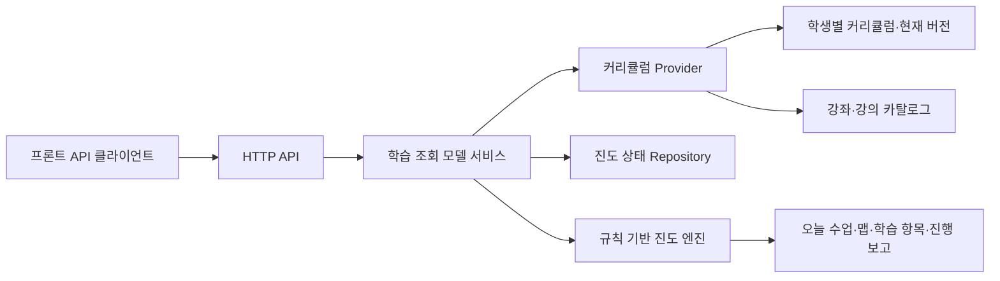

# PostgreSQL 기반 프론트엔드 학습 화면 조회 설계

## 1. 목적

프론트엔드가 이미 호출하는 API 경로와 응답 화면 구조를 유지하면서, `PERSISTENCE_MODE=postgres`에서는 학생별 커리큘럼의 현재 버전을 PostgreSQL에서 읽어 오늘 수업, 커리큘럼 맵, 학습 항목으로 반환한다.

규칙 기반 진도 판단은 백엔드에 남는다. DB는 커리큘럼 구조와 실행 상태의 원본이며, 프론트는 규칙을 다시 계산하지 않는다.

## 2. 데이터 원본과 책임



| 데이터 | PostgreSQL 원본 | 사용처 |
| --- | --- | --- |
| 후보·활성 커리큘럼, 단계, 학습 항목 | `student_curricula`, `curriculum_versions`, `curriculum_steps`, `curriculum_items` | 목록, 오늘 수업, 맵, 학습 항목 |
| 실행 상태와 충돌 방지 번호 | `student_learning_states` | 완료·연기·취약 개념·수업량·revision |
| 실제 강의와 재생 대상 | `courses`, `lessons` | lecture 항목 상세와 재생 정보 |

`student_curricula.state_json`은 seed·전환용 초기 상태로만 둔다. 실행 중 상태를 `student_learning_states`와 함께 갱신하지 않는다.

## 3. Provider와 도메인 매퍼

### Provider 계약

```ts
type CurriculumProvider = {
  listCurriculums(studentId: string, subjectCode: string): Promise<CurriculumSummarySource[]>;
  getActiveCurriculum(studentId: string, subjectCode: string): Promise<ResolvedCurriculum | undefined>;
  getCurriculum(studentId: string, curriculumId: string): Promise<ResolvedCurriculum | undefined>;
};
```

- `MemoryCurriculumProvider`: 기존 mock 배열을 반환한다.
- `PostgresCurriculumProvider`: 활성 `student_curricula`의 `current_version_id`가 가리키는 단계·항목을 반환한다.
- PostgreSQL 모드에서 현재 커리큘럼을 찾지 못했을 때 mock으로 대체하지 않는다.

학생은 과목별로 활성 커리큘럼을 하나씩 가질 수 있으므로, 활성 조회에는 반드시 `subjectCode`가 필요하다. PostgreSQL 모드의 프론트 요청도 `studentId`와 `subjectCode`를 함께 전송한다. 현재 데모 화면의 과목 범위는 `math-logarithm`이며, 메모리 모드는 이 값을 받아도 기존 mock 흐름을 유지한다.

`ResolvedCurriculum`은 기존 진도 엔진이 처리할 수 있는 일반화된 `CurriculumDefinition`과 학습 항목별 재생 정보를 함께 가진다. 커리큘럼·단계·항목의 API 식별자는 DB 행 ID가 아니라 명시적으로 저장된 안정적 `sourceId`를 사용한다. 따라서 새 버전이 생성돼도 동일한 학습 항목의 API 식별자를 유지할 수 있다.

기존 `CurriculumId`의 세 mock 값 union은 `string` 기반 식별자로 일반화한다. 그렇지 않으면 DB의 학생별 커리큘럼 ID를 진도 엔진에 전달할 수 없다.

### DB 행 매핑 규칙

| DB 값 | 도메인·API 값 |
| --- | --- |
| `curriculum_steps.source_id`, `curriculum_items.source_id` | `step.id`, `lessonItem.id` |
| `sequence` | 단계와 항목의 표시·계산 순서 |
| `kind`, `concept_tags`, `estimated_minutes`, `required`, `reason` | 학습 항목 속성 |
| `lesson_id` | lecture의 강좌 카탈로그·재생 정보 연결 키 |
| nullable `goal`, `description`, `reason` | API가 요구하는 문자열로 결정적 기본 문구를 적용 |

lecture 항목은 `lesson_id → lessons.playback_target_id`를 거쳐 기존 백엔드 소유 mock 재생 자산을 연결한다. 연결된 강의나 재생 대상이 없으면 보완용 프론트 mock을 만들지 않고 API 오류로 반환한다.

재생 API의 오류 계약은 다음으로 고정한다.

| 상황 | HTTP 상태 | 오류 코드 |
| --- | --- | --- |
| 현재 버전에 학습 항목이 없음 | 404 | `LESSON_ITEM_NOT_FOUND` |
| lecture가 아닌 항목의 재생 요청 | 404 | `PLAYBACK_NOT_AVAILABLE` |
| lecture의 `lesson_id`가 없음 또는 연결 강의가 없음 | 500 | `CURRICULUM_DATA_INVALID` |
| 강의의 `playback_target_id`가 없음 | 422 | `PLAYBACK_NOT_CONFIGURED` |
| 재생 대상은 있으나 백엔드 자산을 찾지 못함 | 500 | `PLAYBACK_ASSET_MISSING` |

`lesson_id` 누락과 존재하지 않는 강의 연결은 DB 제약과 seed 검증에서 먼저 막아야 한다. API의 500 응답은 손상된 기존 데이터나 운영 설정 오류를 진단하기 위한 방어선이다.

`0002_curriculum_read_model.sql`에서 아래 컬럼과 제약을 추가했고, repository는 DB ID를 파싱하지 않고 `source_id`를 직접 읽고 저장합니다.

```text
curriculum_steps.source_id 추가
curriculum_items.source_id 추가
UNIQUE (curriculum_version_id, source_id)
UNIQUE (curriculum_step_id, source_id)
```

기존 개발 seed의 역호환 backfill도 해당 마이그레이션에서 한 번만 수행합니다.

## 4. 프론트 API별 조회 경로

| API | PostgreSQL 모드의 원본과 계산 |
| --- | --- |
| `GET /api/curriculums?subjectCode` | 해당 과목의 `student_curricula` 후보 목록과 프레젠테이션 메타데이터. `selected`는 active 상태, `currentStepId`는 활성 커리큘럼의 실행 상태에서 계산 |
| `GET /api/student-context?subjectCode` | 해당 과목의 `student_learning_states` 실행 상태 |
| `GET /api/learning-snapshot` | 활성 DB 커리큘럼 1개와 실행 상태를 한 번 읽어 오늘 수업·맵·진행 보고를 계산 |
| `GET /api/today-session` | 활성 DB 현재 버전 + 실행 상태 + 규칙 엔진 |
| `GET /api/today-session/progress` | 활성 DB 현재 버전의 학습 항목 + 실행 상태 |
| `GET /api/curriculum-map` | 활성 DB 현재 버전의 단계 순서 + 실행 상태 |
| `GET /api/lesson-items/:lessonItemId` | 활성 DB 현재 버전에서 `sourceId`로 항목 조회 후 강의 연결 |
| `GET /api/lesson-items/:lessonItemId/playback` | 항목의 `lessonId`와 `lessons.playback_target_id`로 재생 자산 조회 |

모든 학습 화면 API는 `subjectCode`로 범위를 제한한다. `POST /api/student-context/curriculum`도 `studentId`, `subjectCode`, `curriculumId`를 함께 받아 같은 과목의 후보만 선택할 수 있게 한다.

한 응답 안에서 여러 항목을 계산하는 snapshot은 provider가 같은 `current_version_id`를 한 번만 읽은 결과를 재사용한다. 또한 DB는 하나의 읽기 전용 `REPEATABLE READ` 트랜잭션 또는 동등한 단일 read-model 쿼리 안에서 활성 커리큘럼 구조와 해당 과목의 실행 상태를 함께 읽어야 한다. 구조 변경과 실행 상태 변경도 같은 쓰기 트랜잭션으로 커밋한다. 이 경계가 없으면 새 구조와 이전 실행 상태가 섞일 수 있다.

`POST /api/lesson-feedback`, 조율 제안, 조율 확정, 연기 도구도 먼저 활성 provider에서 학습 항목 존재 여부를 검증한 뒤 실행 상태만 갱신한다.

## 5. 프론트 API 계약

경로와 핵심 응답 필드는 유지한다. 전환 시 프론트 API 타입은 다음만 조정한다.

```ts
type ApiDataSource = "mock" | "postgres";
```

기존 `dataSource: "mock"` 고정 타입은 위 union으로 바꾼다. 메모리 모드의 응답 표기는 기존처럼 `mock`을 유지해 프론트가 임시 응답을 구성하는 코드까지 한 번에 바꾸지 않는다. 이 필드는 진단용이며 화면 로직의 분기 기준으로 사용하지 않는다.

현재 프론트 타입의 `nextRecommendedLesson`은 백엔드 응답의 `nextRecommendedItem`과 이름이 다르므로, DB 전환과 별개로 기존 클레임 기준에 맞춰 통일한다. `deferredLessonItemIds`와 `subjectCode`도 학생 상태 타입에 반영한다.

## 6. 초기 진입 규칙

개발 seed는 세 후보를 모두 `candidate`로 유지한다. 이는 사용자가 커리큘럼을 선택하는 데모 핵심 흐름을 보존한다.

프론트 초기 진입은 먼저 건강 상태와 해당 과목의 후보 목록만 조회한다. 활성 커리큘럼이 없으면 `GET /api/student-context`, 오늘 수업·맵·항목 API가 `409`와 `CURRICULUM_SELECTION_REQUIRED`를 반환하고, 프론트는 이미 존재하는 커리큘럼 선택 화면을 바로 표시한다. 이는 인증 도입과 무관하게 이번 전환에서 함께 처리한다.

사용자 선택은 성공 응답의 snapshot을 기준으로 홈을 표시한다. 후보 선택은 active 상태와 해당 과목 실행 상태의 `selectedCurriculumId`를 하나의 트랜잭션에서 갱신한다.

## 7. 구현된 DB 계약

프론트 목록이 요구하는 설명·추천 대상·교사 코멘트는 `student_curricula.presentation_json`에 저장합니다. 제목이나 세 데모 ID에서 이를 추론하지 않습니다.

고정 소개 정보는 `student_curricula.presentation_json`에 저장한다.

```json
{
  "paceLabel": "안정형",
  "description": "커리큘럼 소개",
  "recommendedFor": ["추천 대상"],
  "teacherComment": "AI 담임 안내"
}
```

`paceLabel`은 선택적 자유 문자열이며 안정형·압축형·문제적용형 값으로 제한하지 않는다. 구조 변경에 따라 달라지는 변경 사유와 설명은 이미 `curriculum_versions.change_reason`, `change_summary`로 관리하며, 버전별 소개 정보가 실제로 필요하다고 확인되기 전에는 중복 저장하지 않는다.

DB 구현은 `sourceId`, presentation JSON, 과목별 실행 상태, `REPEATABLE READ READ ONLY` 읽기 경계와 후보 선택 Unit of Work를 제공합니다. 개별 요청 문서는 로컬 `docs/claims/`에만 보관하며 Git에서는 추적하지 않습니다.

## 8. 구현 순서

1. 완료: DB가 sourceId·presentation JSON·과목별 실행 상태·일관된 읽기 경계·선택 Unit of Work를 제공한다.
2. 백엔드가 일반화된 커리큘럼 타입과 memory/postgres provider를 추가한다.
3. PostgreSQL 진도 서비스가 provider의 활성 커리큘럼을 규칙 엔진 입력으로 사용하게 한다.
4. 조회 API 전체의 오류 응답을 전환하고 API 문서를 갱신한다.
5. 프론트 API 타입의 data source와 추천 항목 이름을 맞춘다.
6. 메모리 모드와 PostgreSQL 모드를 각각 회귀 테스트한다.

## 9. 완료 검증

- PostgreSQL에서 버전 2를 저장하면 오늘 수업·맵·학습 항목이 버전 2의 `sourceId`와 순서를 반환한다.
- mock 배열을 수정해도 PostgreSQL 모드의 조회 응답은 변하지 않는다.
- lecture 항목의 상세와 재생 URL은 DB `lesson_id` 연결로만 생성된다.
- DB 통합 테스트는 snapshot 계산에 사용한 `current_version_id`와 실행 상태 revision이 같은 DB 읽기 경계에서 얻어진 값인지 확인한다.
- 후보 선택이 실패하면 active 커리큘럼과 실행 상태가 어긋나지 않는다.
- 학생 A의 DB 커리큘럼 변경은 학생 B의 모든 조회 응답에 영향을 주지 않는다.
- 프론트는 같은 API 경로로 메모리와 PostgreSQL 모드 모두에서 화면을 표시한다.
