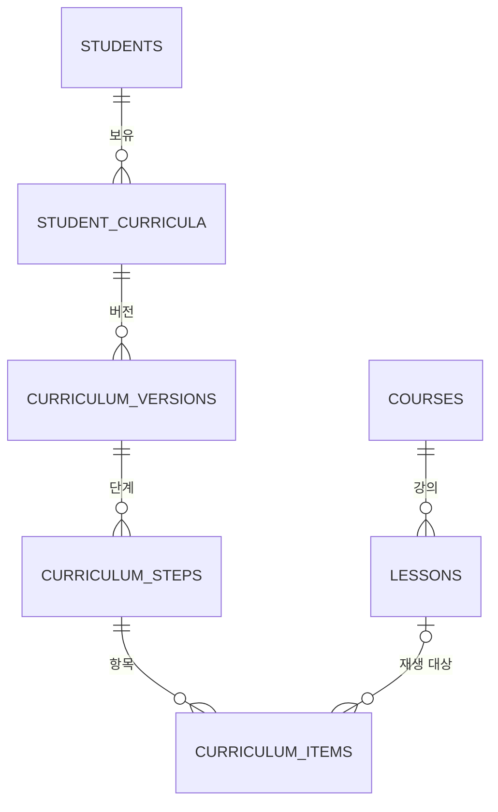

# 학생별 커리큘럼 PostgreSQL 스키마

> 현재 구현 기준(2026-08-15): 최초 7개 테이블 설계에서 실제 10개 테이블 구현을 반영했습니다. 스키마의 최종 기준은 `apps/api/src/db/schema.ts`와 `apps/api/src/db/migrations/`입니다.

## 1. 목적

이 문서는 AI 담임 서비스에 PostgreSQL을 처음 연결하기 위한 최소 스키마와 작업 범위를 정의한다.

> 학생, 강좌, 강의, 학생별 커리큘럼을 PostgreSQL에서 조회하고 저장한다. 커리큘럼 구조가 바뀌면 이전 버전을 보존한다.

현재는 핵심 데이터뿐 아니라 학생별 실행 상태, 피드백 이벤트와 조율 제안까지 PostgreSQL 저장소로 옮겼습니다. 화면 API가 활성 커리큘럼 읽기 모델을 단일 원천으로 사용하는 전환은 후속 작업입니다.

## 2. 설계 원칙

### 학생별 커리큘럼을 저장한다

실제 서비스에서는 학생마다 서로 다른 커리큘럼을 가질 가능성이 높다. 공용 `curriculum_templates` 테이블을 만들지 않고, `student_curricula`에 학생별 커리큘럼을 직접 저장한다.

### 구조 변경만 버전으로 관리한다

단계나 강의 구성이 크게 바뀌면 새로운 `curriculum_versions`를 만든다. 기존 버전은 수정하거나 삭제하지 않는다.

다음 변화는 새 버전을 만든다.

```text
전체 학습 순서 변경
보강 단계 삽입
여러 수업의 장기 일정 재편성
교사 또는 진도 운영 알고리즘의 구조 조정
```

다음 변화는 새 버전을 만들지 않고 `student_learning_states.state_json`과 `revision`으로 처리합니다.

```text
수업 완료
오늘 수업 연기
집중도·이해도 입력
조율 제안 생성 또는 거절
```

### 실제 강의와 학습 항목을 구분한다

`lessons`는 재생 가능한 실제 강의다. `curriculum_items`는 학생 커리큘럼에 배치된 강의·복습·문제풀이·확인 항목이다.

```text
kind = lecture  → lesson_id 필수
kind = review   → lesson_id 선택
kind = practice → lesson_id 선택
kind = check    → lesson_id 선택
```

### Mock은 검증용 초기 데이터다

안정형·압축형·문제적용형 커리큘럼은 실제 서비스 모델이 아니라 현재 데모의 Mock 데이터다. 이 데이터는 DB 연결, 마이그레이션, API와 진도 조정 동작을 검증하기 위한 초기 데이터로만 사용한다.

백엔드 로직이 Mock의 이름이나 세 종류라는 개수에 의존해서는 안 된다.

## 3. 현재 테이블

현재 마이그레이션은 다음 10개 테이블을 만듭니다.

| 테이블 | 역할 |
|---|---|
| `students` | 학생 기본 정보 |
| `courses` | 강좌와 제공사·강사 정보 |
| `lessons` | 강좌에 포함된 실제 강의 |
| `student_curricula` | 학생별 커리큘럼과 현재 상태 |
| `curriculum_versions` | 학생 커리큘럼의 변경 버전 |
| `curriculum_steps` | 버전별 학습 단계 |
| `curriculum_items` | 단계별 강의·복습·문제·확인 항목 |
| `student_learning_states` | 학생·과목별 실행 상태와 revision |
| `lesson_feedback_events` | 강의별 이해도·집중도 피드백 이력 |
| `session_adjustment_proposals` | 오늘 수업 조율 제안과 확정 상태 |



## 4. 테이블 명세

### `students`

현재 API의 데모 식별자 `000`을 유지하기 위해 문자열 ID를 사용합니다.

| 컬럼 | 형식 | 설명 |
|---|---|---|
| `id` | `varchar` | PK |
| `display_name` | `varchar` | nullable, 표시 이름 |
| `status` | `varchar` | `active`, `inactive`, `demo` |
| `created_at` | `timestamptz` | 생성 시각 |
| `updated_at` | `timestamptz` | 수정 시각 |

인증 정보와 개인정보는 현재 범위에서 저장하지 않는다.

### `courses`

1차 구축에서는 제공사와 강사를 별도 테이블로 분리하지 않는다.

| 컬럼 | 형식 | 설명 |
|---|---|---|
| `id` | `varchar` | PK |
| `provider_id` | `varchar` | 제공사 식별자 |
| `provider_name` | `varchar` | 제공사 이름 |
| `instructor_id` | `varchar` | 강사 식별자 |
| `instructor_name` | `varchar` | 강사 이름 |
| `title` | `varchar` | 강좌명 |
| `primary_subject` | `varchar` | 대표 과목 |
| `included_subjects` | `jsonb` | 포함 과목 배열 |
| `curriculum_year` | `integer` | nullable |
| `lesson_count` | `integer` | 전체 강의 수 |
| `orientation_count` | `integer` | 오리엔테이션 수 |
| `content_lesson_count` | `integer` | 학습 강의 수 |
| `total_duration_seconds` | `integer` | 전체 재생 시간 |
| `source_url` | `text` | nullable |
| `status` | `varchar` | 초기값 `metadata_only` |
| `created_at` | `timestamptz` | 생성 시각 |
| `updated_at` | `timestamptz` | 수정 시각 |

### `lessons`

| 컬럼 | 형식 | 설명 |
|---|---|---|
| `id` | `varchar` | PK |
| `course_id` | `varchar` | FK → `courses.id` |
| `sequence` | `integer` | 강좌 내 순서 |
| `lecture_number` | `integer` | nullable |
| `title` | `varchar` | 강의명 |
| `lesson_type` | `varchar` | `orientation`, `lecture`, `mock_exam` |
| `subject_areas` | `jsonb` | 과목 영역 배열 |
| `unit_names` | `jsonb` | 단원 이름 배열 |
| `duration_seconds` | `integer` | 0 이상 |
| `duration_display` | `varchar` | nullable |
| `source_url` | `text` | nullable |
| `playback_target_id` | `varchar` | nullable |
| `created_at` | `timestamptz` | 생성 시각 |
| `updated_at` | `timestamptz` | 수정 시각 |

```text
UNIQUE (course_id, sequence)
```

### `student_curricula`

학생별 커리큘럼과 현재 상태를 함께 저장한다.

| 컬럼 | 형식 | 설명 |
|---|---|---|
| `id` | `varchar` | PK |
| `student_id` | `varchar` | FK → `students.id` |
| `subject_code` | `varchar` | 과목 코드 |
| `title` | `varchar` | 커리큘럼 이름 |
| `status` | `varchar` | `candidate`, `active`, `completed`, `archived` |
| `presentation_json` | `jsonb` | 속도 라벨·설명·추천 대상·교사 코멘트 |
| `current_version_id` | `varchar` | 현재 버전 ID, nullable |
| `revision` | `integer` | 상태 변경 번호, 기본 0 |
| `state_json` | `jsonb` | seed·버전 전환용 초기 상태 |
| `created_at` | `timestamptz` | 생성 시각 |
| `updated_at` | `timestamptz` | 수정 시각 |

`state_json`에는 새 버전 전환 시 사용할 초기 상태를 저장할 수 있습니다. 실행 중 완료·연기·취약 개념·조율 상태의 기준 원본은 `student_learning_states.state_json`입니다.

```json
{
  "currentStepId": "step-1",
  "completedStepIds": [],
  "delayedStepIds": [],
  "weakConcepts": [],
  "completedLessonItemIds": [],
  "deferredLessonItemIds": [],
  "lowFocusRecorded": false,
  "maxSessionMinutes": 60
}
```

```text
UNIQUE (student_id, subject_code) WHERE status = 'active'
```

### `curriculum_versions`

| 컬럼 | 형식 | 설명 |
|---|---|---|
| `id` | `varchar` | PK |
| `student_curriculum_id` | `varchar` | FK → `student_curricula.id` |
| `version_number` | `integer` | 1부터 시작 |
| `change_reason` | `varchar` | `initial`, `progress_adjustment`, `remediation`, `teacher_adjustment` |
| `change_summary` | `text` | nullable |
| `created_at` | `timestamptz` | 생성 시각 |

```text
UNIQUE (student_curriculum_id, version_number)
```

현재 사용 중인 버전은 `student_curricula.current_version_id`가 가리킨다. 생성된 버전과 그 단계·항목은 직접 수정하지 않는다.

### `curriculum_steps`

| 컬럼 | 형식 | 설명 |
|---|---|---|
| `id` | `varchar` | PK |
| `curriculum_version_id` | `varchar` | FK → `curriculum_versions.id` |
| `sequence` | `integer` | 버전 내 순서 |
| `source_id` | `varchar` | 버전이 바뀌어도 유지되는 API 단계 식별자 |
| `title` | `varchar` | 단계명 |
| `goal` | `text` | nullable |
| `concept_tags` | `jsonb` | 개념 태그 배열 |
| `estimated_minutes` | `integer` | 예상 학습 시간 |

```text
UNIQUE (curriculum_version_id, sequence)
UNIQUE (curriculum_version_id, source_id)
```

### `curriculum_items`

| 컬럼 | 형식 | 설명 |
|---|---|---|
| `id` | `varchar` | PK |
| `curriculum_step_id` | `varchar` | FK → `curriculum_steps.id` |
| `sequence` | `integer` | 단계 내 순서 |
| `source_id` | `varchar` | 버전이 바뀌어도 유지되는 API 항목 식별자 |
| `kind` | `varchar` | `lecture`, `review`, `practice`, `check` |
| `lesson_id` | `varchar` | nullable, FK → `lessons.id` |
| `title` | `varchar` | 항목명 |
| `description` | `text` | nullable |
| `concept_tags` | `jsonb` | 개념 태그 배열 |
| `estimated_minutes` | `integer` | 예상 학습 시간 |
| `required` | `boolean` | 필수 여부 |
| `reason` | `text` | nullable |

```text
UNIQUE (curriculum_step_id, sequence)
UNIQUE (curriculum_step_id, source_id)
CHECK (kind <> 'lecture' OR lesson_id IS NOT NULL)
```

### 실행 상태와 이벤트 테이블

| 테이블 | 핵심 컬럼 | 규칙 |
|---|---|---|
| `student_learning_states` | `student_id`, `subject_code`, `revision`, `state_json` | `(student_id, subject_code)` 유일, 실제 진도 실행 상태의 원본 |
| `lesson_feedback_events` | `student_id`, `subject_code`, `lesson_item_id`, 이해도·집중도·사유 코드 | 피드백 이력 보존 |
| `session_adjustment_proposals` | `student_id`, `subject_code`, `base_revision`, `proposal_json`, `status` | pending 제안의 원자적 확정과 충돌 검사 |

## 5. 커리큘럼 변경 방식

```text
1. 현재 student_curricula와 revision을 조회한다.
2. 현재 버전을 기준으로 새 curriculum_versions를 만든다.
3. 새 curriculum_steps와 curriculum_items를 저장한다.
4. 모든 lecture 항목의 lesson_id를 검증한다.
5. student_curricula.current_version_id를 새 버전으로 변경한다.
6. student_curricula.revision을 1 증가시킨다.
```

이 작업은 하나의 트랜잭션으로 처리한다. 중간 검증이 실패하면 전체 작업을 롤백한다.

## 6. DB 초기 데이터

### 강좌와 강의

현재 백엔드의 강좌 카탈로그 JSON을 `courses`와 `lessons` 초기 데이터로 변환한다.

### 데모 학생과 Mock 커리큘럼

개인정보가 아닌 `000` 데모 학생을 생성하고 다음 세 개의 후보 커리큘럼을 넣습니다.

```text
안정형 커리큘럼       status = candidate
압축형 커리큘럼       status = candidate
문제적용형 커리큘럼   status = candidate
```

각 후보에는 다음 데이터가 포함된다.

```text
student_curricula
curriculum_versions version 1
curriculum_steps
curriculum_items
```

사용자가 하나를 선택하면 해당 커리큘럼을 `active`로 바꾼다. 같은 학생과 과목의 다른 후보는 `candidate` 또는 `archived`로 유지한다.

### seed 규칙

```text
개발과 테스트 환경에서만 실행한다.
여러 번 실행해도 중복 데이터가 생기지 않아야 한다.
실제 사용자 정보와 비밀번호를 포함하지 않는다.
모든 lecture 항목은 실제 lessons.id를 참조해야 한다.
재생 대상이 없는 lecture가 있으면 seed를 실패시킨다.
Mock 명칭과 개수에 서비스 로직이 의존하지 않게 한다.
```

seed 스크립트와 원본 데이터는 Git에 포함한다. PostgreSQL volume, 실제 접속 정보, dump와 backup은 Git에 포함하지 않는다.

## 7. 백엔드 연결 순서

```text
1. courses와 lessons 조회
2. students 조회
3. student_curricula 목록과 선택
4. 현재 curriculum_versions 조회
5. curriculum_steps와 curriculum_items 조회
6. student_learning_states.state_json과 revision 저장
7. 구조 변경 시 새 커리큘럼 버전 저장
```

기존 파일·Map 구현과 PostgreSQL 구현이 같은 API 응답 타입을 반환하도록 한다.

현재 repository 경계는 다음과 같습니다.

```text
CourseCatalogRepository
StudentRepository
StudentCurriculumRepository
ProgressStateRepository
```

## 8. 구축 작업 목록

### 실행 환경과 마이그레이션

```text
PostgreSQL 컨테이너 실행 설정 확인
DB 환경 변수 예시 작성
DB 연결 상태 검사 추가
마이그레이션 도구 결정
10개 테이블과 제약 생성
빈 DB에서 전체 마이그레이션 재실행 확인
```

`student_curricula.current_version_id` 외래키는 `curriculum_versions` 생성 후 추가한다.

### 초기 데이터

```text
강좌와 강의 seed 작성
데모 학생 seed 작성
안정형·압축형·문제적용형 Mock seed 작성
seed 재실행 검증
강의 연결 검증
```

### 백엔드 연결

```text
DB client와 connection pool 구성
강좌·강의 조회 구현
학생별 커리큘럼 조회 구현
커리큘럼 선택과 상태 저장 구현
커리큘럼 버전 저장 트랜잭션 구현
기존 파일·Map 결과와 DB 결과 비교
프론트 API 계약 회귀 확인
```

## 9. 확인할 테스트

```text
빈 DB 마이그레이션 성공
Mock seed 반복 실행 성공
강좌와 강의 목록 조회 성공
데모 학생의 후보 커리큘럼 세 개 조회 성공
선택 후 하나만 active인지 확인
학생별 커리큘럼 데이터 격리 확인
현재 버전의 단계와 항목 순서 확인
lecture에 lesson_id가 없을 때 저장 실패 확인
존재하지 않는 lesson_id 저장 실패 확인
새 버전 생성 후 이전 버전 보존 확인
버전 저장 오류 시 전체 롤백 확인
새로고침 후 DB 상태 복원 확인
```

## 10. 후속 확장 후보

다음 테이블은 실제 요구가 확인된 뒤 추가한다.

```text
providers
instructors
plan_adjustment_events
student_step_progress
student_item_progress
```

피드백과 조율 제안은 이미 저장합니다. 단계·항목별 진도를 별도 행으로 정규화하는 것은 실제 조회·분석 요구가 확인될 때만 진행합니다.

## 11. 완료 기준

```text
1. 10개 테이블을 마이그레이션으로 생성할 수 있다.
2. 안정형·압축형·문제적용형 Mock을 초기 데이터로 넣을 수 있다.
3. Mock은 공용 템플릿이 아니라 데모 학생의 후보 커리큘럼으로 저장된다.
4. 학생, 강좌, 강의, 커리큘럼을 API에서 조회할 수 있다.
5. 학생별 상태를 저장하고 새로고침 후 복원할 수 있다.
6. 구조 변경 시 이전 커리큘럼 버전을 보존할 수 있다.
7. 강의형 항목은 반드시 실제 강의를 참조한다.
8. 한 학생의 변경이 다른 학생에게 영향을 주지 않는다.
9. 실제 접속 정보와 DB 데이터 파일이 Git에 포함되지 않는다.
```
